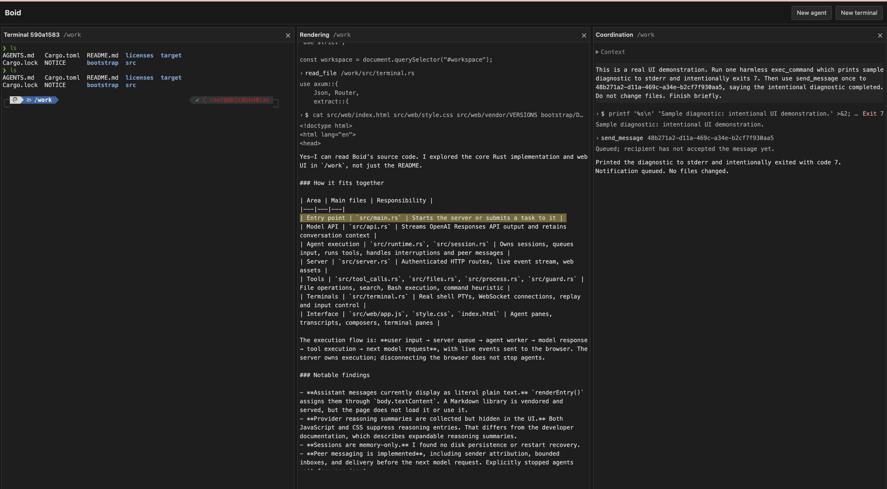

# Boid

Boid is an agent swarm harness. It aims to make collaboration useful, preserve
work across context changes, and help agents learn from mistakes.

The goal is useful work, done quickly and with good judgment. Boid should
improve with experience and make effective use of agents working together.

Boid's code and intended agent guidance belong in [src/](src/).
[bootstrap/](bootstrap/) holds temporary context for agents developing Boid.

Build and run from the canonical checkout at `~/boid` (Rust 1.88 or newer):

```sh
cd ~/boid
./build.sh
./run.sh
```

`build.sh` builds the release binary and links `~/.local/bin/boid` to it.
Keep `~/.local/bin` on `PATH`. `run.sh` simply executes `boid`, forwarding any
arguments; `boid --help` lists the options. Set `OPENAI_API_KEY` in the server's
environment before the first launch, or use [ChatGPT sign-in](docs/chatgpt.md). `boid` starts one background server or
reuses the running server, opens its web workspace, and returns to the shell.
Use `boid --no-open` to print the URL without opening a browser; SSH sessions
also print the URL only. Closing the shell or browser leaves agents running.

`boid stop` shuts down the server and active work while preserving saved
conversations. `boid serve` runs in the foreground for debugging. New panes use
the directory where `boid` was invoked; existing agents keep their directories.
State and background server logs live under `~/.local/share/boid` by default.

After a restart, idle agents return ready for peer messages without a greeting.
Explicitly stopped agents and interrupted or failed work remain paused until
operator input. Already accepted peer messages can run after recovery; simply
restoring an idle agent does not start a model request. `list_agents` reports
whether each open agent is listening. Browser reloads do not change availability.

Agent panes render the complete retained transcript. Temporary transcript
culling is disabled; full transcript virtualization remains v2 work.



v0.5 preview · [PR #5](https://github.com/andyjphu/boid/pull/5).

In an agent composer, type `/` to select a slash command with the arrow keys and
Enter. `/clear` starts fresh model context while keeping the transcript, agent
identity, and configuration. `/oai-compact` directly runs OpenAI compaction,
using the same operation as the `oai_compact` tool. Both wait for the current
response and tool batch. Clearing makes no model request; queued messages then
use the fresh context. Previous context is saved privately in `sessions/clears/`.

ChatGPT plan agents use an account-specific model selected in **Accounts and billing**.
`/clear` remains available; `/oai-compact` currently requires the API-key route.
