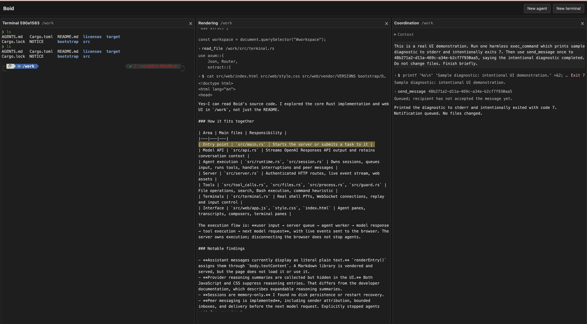

# Boid

Boid is an agent swarm harness. It aims to make collaboration useful, preserve
work across context changes, and help agents learn from mistakes.

The goal is useful work, done quickly and with good judgment. Boid should
improve with experience and make effective use of agents working together.
[Performance profiling and the speed mandate](docs/performance.md) guide work
on harness overhead.
[Context blocks](docs/context-blocks.md) separate stable guidance, current peer
status, and each agent's editable working note.

[Usage diagnostics](docs/diagnostics.md) are sunset and hidden. Their accounting
is not currently reliable; the existing components remain for a later revisit,
with maintenance stopped.

Boid's code and intended agent guidance belong in [src/](src/).
[bootstrap/](bootstrap/) holds temporary context for agents developing Boid.

Build and run from the canonical checkout at `~/boid` (Rust 1.89 or newer):

```sh
cd ~/boid
./build.sh
./run.sh
```

`build.sh` builds the release binary and links `~/.local/bin/boid` to it.
Keep `~/.local/bin` on `PATH`. `run.sh` simply executes `boid`, forwarding any
arguments; `boid --help` lists the options. The lock button, also opened by
`/login`, manages named API keys and [ChatGPT subscriptions](docs/chatgpt.md).
An existing `OPENAI_API_KEY` is imported once into that registry.
`boid` starts one background server or
reuses the running server, opens its web workspace, and returns to the shell.
Use `boid --no-open` to print the URL without opening a browser; SSH sessions
also print the URL only. Closing the shell or browser leaves agents running.

`boid stop` shuts down the server and active work while preserving saved
conversations. `boid serve` runs in the foreground for debugging. New agents
start in the server home directory with a provisional bird name. Empty agents,
including renamed or configured ones, remain in memory until their first message
or actual work. They survive browser refresh but disappear on server restart;
closing them leaves no saved trace. Automatic names are reserved when work starts
and may change then if another agent has taken that name. Existing saved agents
keep their names and directories. Terminals retain the workspace directory selected
by the launcher or `BOID_CWD`. `boid "task"` also starts its agent at home.
State and background server logs live under `~/.local/share/boid` by default.
For browser access without copying a server token, use
[SSH-authorized passkey enrollment](docs/passkeys.md).

After a clean restart, idle agents return ready for peer messages without a
greeting. Explicitly stopped agents remain paused until operator input. After
an unclean shutdown, unfinished actions and queued work are retained for review
instead of automatically replayed. Fresh operator input can continue the agent.
Browser reloads do not change agent availability.

Model responses, tool starts/results, peer delivery and streaming update accepted
server memory immediately. A background recorder saves them without making
execution wait for disk. When recording falls behind, queued updates coalesce
into the latest complete state, retaining transcript content while bounding the
recording queue. A crash can lose the unsaved tail, including recent tool results;
recovery treats unfinished actions as uncertain. End and graceful shutdown drain
the recorder. Previously saved transcripts remain preserved.

Rapid composer submissions retain their order across pane and screen changes.
A draft clears only when the server acknowledges that exact draft revision.
Unconfirmed submissions remain available for manual review and retry after a
failure or reload; recovery storage does not block sending.

Paste an image into the agent composer with Command-V (Ctrl-V on other systems).
Blue `[Image #1]` markers identify attachments; use their × to remove them.
Send images with text or on their own. Uploads run while typing continues, and
sending waits for the attachments. [Image formats and storage](docs/images.md).

Agent panes retain the complete transcript and load recent history first.
[Earlier history loads on demand](docs/history.md); rendering follows the viewport.
The main agent button creates an agent immediately. Each pane's trailing `+`
adds an agent tab to that pane. Selecting a tab expands it in place; inactive
tabs show only their names. Drag tabs to reorder or group agents and terminals,
and scroll overflowing tab strips horizontally. Tab membership, order and
credentials are shared across browser windows. Selected tabs and resized
positions survive refresh in that browser window. Right-click either agent
creation button to find active agents.
Drag a pane's empty header area to move the whole pane, or drag an individual
tab onto a screen number to move that session to another screen. An empty window
is removed when leaving it. Hidden agent tabs and running or starting terminals
keep their window open. Window numbers are display labels; stable window IDs
preserve assignments across browsers, and at least one window remains.

Each pane has one [credential](docs/credentials.md) for all its agent tabs,
including background tabs. Changing or removing it takes effect on the next
model request; an in-progress request keeps its current credential. Removal
leaves affected panes unassigned. Background agents continue working normally.

Ending an agent removes it from Boid. Its [archived trace files](docs/archives.md)
remain on disk for manual reading or reconstructing a new agent. Archived agents
have no history picker or reopen action and do not remain loaded in the harness.



v0.5 preview · [PR #5](https://github.com/andyjphu/boid/pull/5).

In an agent composer, type `/` to select a slash command with the arrow keys and
Enter. `/clear` starts fresh model context while keeping the transcript, agent
identity, and configuration. `/oai-compact` directly runs OpenAI compaction,
using the same operation as the `oai_compact` tool. Both wait for the current
response and tool batch. Clearing makes no model request; queued messages then
use the fresh context. Previous context is saved privately in `sessions/clears/`.

Agents can call `prompt_user` for important questions. Blocking questions open
a reply panel and mark the agent pane in red. Other questions collect behind
the pane's Questions button, with a picker when several are open. Replies appear
in the conversation and reach the agent as user messages.

The agent sets `blocking` and `wait_seconds` (1–86400 seconds; null means five
minutes for a blocking question). Nonblocking questions use null and return
immediately. When a wait expires, the agent receives a timeout result and can
decide what authorized work to continue. The question remains answerable; silence
does not grant approval. Repeating the same open question reuses its ID and
original deadline. Stop and Escape end the wait, while retaining the question.
Questions survive reconnects and server restarts. Restarts preserve the usual
paused recovery behavior; they do not restart a question's timer or agent work.

`/login` opens the shared credential view. `/model` selects a model
from the connected account's catalog. `/fast` toggles Fast mode for that agent;
`/fast on` and `/fast off` set it explicitly. The setting applies to the next
model request and preserves model and reasoning effort. Subscription access is
checked against that account's model catalog; API keys use priority processing.
`/clear` remains available; `/oai-compact` currently requires the API-key route.

### Measuring message admission

Browser input diagnostics are off by default. Open the page with
`?input-timing=1`, or call `boidInputTiming.enable()` in the browser console.
Send a normal message, then inspect
`boidInputTiming.samples()`. Use `boidInputTiming.clear()` to remove retained
samples and `boidInputTiming.disable()` to stop recording. Diagnostics retain
at most 64 samples in memory and do not retain message contents or write disk
logs. Correlation uses the server's message ID and local monotonic durations;
it does not subtract clocks from different machines.

Message responses retain their existing JSON and include `Server-Timing`
durations in milliseconds:

- `boid_lock`: waiting to acquire the server's session-state mutex.
- `boid_mutate`: work while that mutex is held, including history copies,
  mutation, persistence enqueueing, event publication, and worker notification.
- `boid_admit`: runtime method entry through mutex release and the return from
  the synchronous admission wrapper. This does not wait for background saving.
- `boid_handler`: HTTP handler entry after Axum extraction through response-body
  construction. It excludes authentication, request-body extraction, final
  timing-header formatting, socket flush, and client receipt.

Browser `submitToDispatchMs` includes any local wait behind an earlier explicit
submission. Browser submit-to-headers and submit-to-acknowledgment timings
include that wait; server metrics do not. These intervals overlap;
do not add them together. Handler-level failures also
include timing for stages reached. Authentication and extraction failures do
not reach this handler and have no admission metrics. Browser rendering timings
report DOM work, not when pixels became visible. No latency figure in the test
fixtures establishes production speed: inspect samples from actual messages to
measure the current browser and server.
